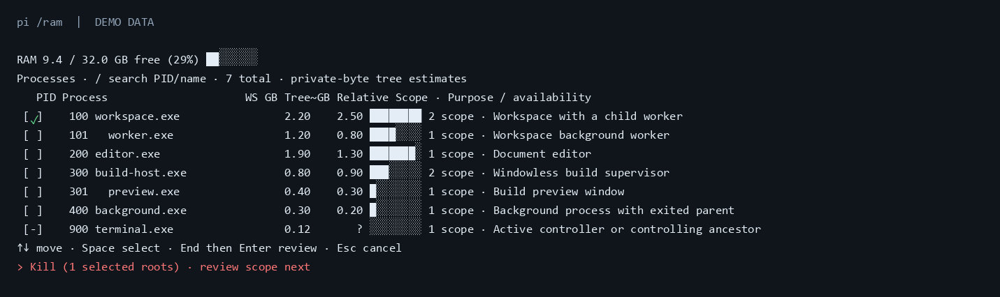

# pi-ram-meters

A Windows RAM dashboard and process-control picker for [pi](https://pi.dev/).

Run /ram to inspect memory and choose which processes to close. Every program uses the same process-identity and tree logic. Names and descriptions are labels; there is no supported-program list or product-specific stop command.

Descriptions use the program's own Windows label. Missing labels remain unknown.

The image contains synthetic data rendered by the extension, with no live process or session information.

## Install

    pi install git:github.com/Quigleybits/pi-ram-meters-extension@v0.1.0

Restart pi or reload its extensions.

Requirements: Windows, Windows PowerShell 5.1 and Node.js 22.19 or newer. No program-specific tools are required. Linux and macOS are not supported. Distribution is through GitHub; this version is not published on npm.

## Choose the process scope

    /ram
    /ram --read-only

Use the compact checkbox table to select processes. Space toggles a row. Review the root preview, choose a close mode, then explicitly confirm its unsaved-data warning. The final confirmation starts on Cancel.

The selected PID is the default root. Its verified parent chain, windows and resulting scope help you choose an ancestor instead. This is useful when a parent keeps recreating a child. A windowless parent, a GUI child and a worker can also be a launcher with independent work; process metadata alone cannot determine your intent. The tool shows the choice instead of silently broadening it.

Every process is reachable, including background, orphan, service and non-top-ten entries. Permission and identity failures remain visible with a reason.

| Mode | Effect |
| --- | --- |
| End task | Requests closure of the confirmed roots' windows, then forcibly terminates original roots that remain after fresh safety checks. A save prompt or no visible window does not prevent the confirmed fallback. Children are not directly forced and can remain. |
| End process tree | Forcibly terminates confirmed roots and all verified descendants in their scope, including GUI processes and newly verified children. Parents stop before children. There is no save opportunity. |

Both modes can lose unsaved work or interrupt active tasks. A tree can include other programs launched by its root. Review the root PIDs and scope before confirming. Root choice never expands to an entire Windows session.

## Memory figures

GB uses decimal bytes: 1 GB = 1,000,000,000 bytes.

- Free / total RAM is available physical memory and total physical memory.
- Working set includes shared pages and is not exclusive physical RAM.
- Private bytes are a separate process allocation measure. Any release estimate derived from them is not guaranteed recovered physical RAM, especially when End task leaves children.
- Unknown measurements remain unknown. Different measures are not added together.

## Results and limits

The extension validates PID, birth, image, session and account facts and uses retained process handles. Generic OS critical-process, permission and controller checks apply. The active RAM controller and its controlling ancestors are protected; other programs do not receive name-based exemptions. There is no automatic elevation.

Tree mode adopts only newly verified descendants of confirmed roots while its bounded operation is healthy. Unrelated roots are excluded. Missing ancestry, denied access, reused PIDs, unsafe descendants or exhausted budgets produce partial or unconfirmed results instead of silently pruning a tree and claiming success. No automatic retry follows a failed or uncertain result.

After execution, separated read-only process samples report survivors, new verified lineage and incomplete observation over a stated bounded interval. If an outside supervisor starts a replacement after all known lineage ends, ancestry may not prove that association. The tool does not infer respawn from an image or program name, promise semantic application shutdown, or detect every later or short-lived restart.

Read-only and noninteractive/RPC use display measurements without close actions. There is no background cleanup, polling, telemetry, saved process log or agent-callable termination tool. Process command lines are not used to classify programs. Pi itself has separate configuration and behavior.

## License

MIT. Copyright 2026 quigleybits.
